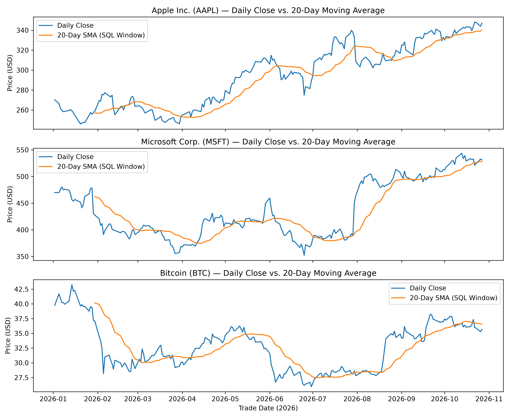

# Financial Market Database & Time-Series SQL Analytics

This project fetches historical daily market data (`AAPL`, `MSFT`, `BTC-USD`) via the Yahoo Finance API (`yfinance`), stores it in a normalized two-table SQLite relational database (`market.db`), and calculates time-series indicators—such as daily percentage returns and 20-day moving averages—directly in SQL using Common Table Expressions (CTEs) and Window Functions.

---

## 1. Database Schema (`market.db`)

To avoid repeating company metadata across hundreds of daily price rows, the database uses two connected tables linked by a Foreign Key (`asset_id`):

* **`assets` (Parent Table):** Stores unique asset details (`asset_id` PRIMARY KEY, `ticker`, `asset_name`, `asset_class`).
* **`daily_prices` (Child Table):** Stores historical daily prices and volume (`price_id` PRIMARY KEY, `asset_id` FOREIGN KEY, `trade_date`, `close_price`, `volume`) with a `UNIQUE(asset_id, trade_date)` constraint to prevent duplicate entries.

---

## 2. Key SQL Queries 

### A. Asset Summary Statistics (`JOIN` & `GROUP BY`)
Combines both tables to summarize total trading days, minimum, maximum, and average closing price per asset.

### B. Daily Percentage Returns (`WITH` CTE & `LAG` Window Function)
Uses `LAG()` partitioned by `asset_id` to pull the previous trading day's closing price onto the current row and calculate daily percentage returns:

### C. 20-Day Simple Moving Average 
Computes a rolling 20-day moving average directly in SQL using `ROWS BETWEEN 19 PRECEDING AND CURRENT ROW`:

## 3. Visualization Output (`analyze.py`)

The SQL moving average query is loaded directly into Pandas via `pd.read_sql()` and plotted with Matplotlib.



---

## 4. How to Run This Project

1. Install required Python libraries:
   ```bash
   pip install yfinance pandas matplotlib
   ```
2. Build the database and tables:
   ```bash
   python setup_db.py
   ```
3. Download market data and populate `market.db`:
   ```bash
   python load_data.py
   ```
4. Run the SQL moving average query and generate the plot:
   ```bash
   python analyze.py
   ```
